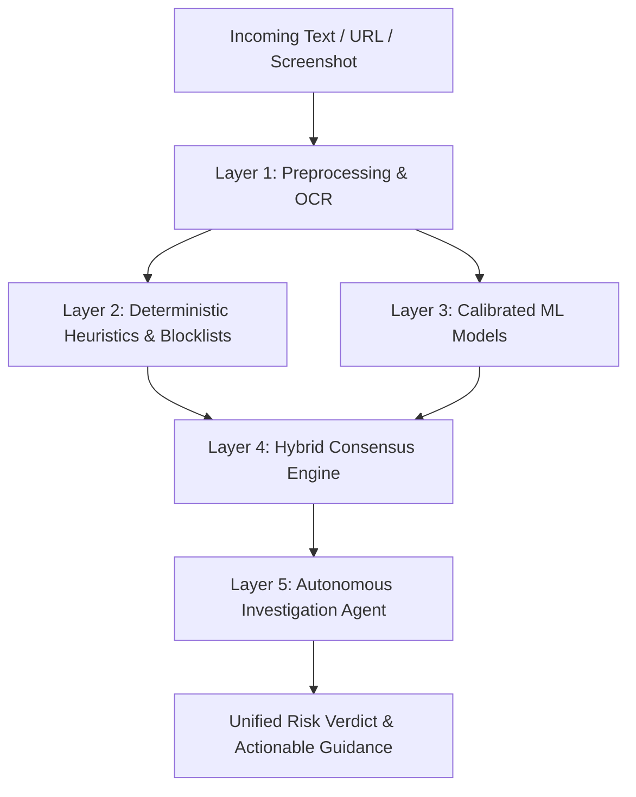

# 🛡️ ScamLens Threat Models & Attack Vectors

This document outlines the threat landscape, scam taxonomies, evasion techniques, and detection strategies used across the ScamLens security platform, tailored specifically for the Indian digital payment and cybersecurity ecosystem.

---

## 1. Indian Scam Taxonomies (12 High-Impact Vectors)

ScamLens monitors and scores 12 distinct scam categories prevalent across SMS, WhatsApp, Telegram, and mobile web channels:

| # | Scam Vector | Typical Target / Hook | Common Indicators | Severity |
|---|-------------|------------------------|-------------------|----------|
| 1 | **Electricity / Utility Disconnection** | "Power will be cut at 9:30 PM tonight due to pending bill" | Unofficial mobile numbers, urgency, fake bill link (`.apk` or web portal) | Critical |
| 2 | **Bank KYC / Account Freeze** | "Your SBI/HDFC account blocked due to incomplete KYC" | PAN/Aadhaar update urgency, deceptive domain impersonation | Critical |
| 3 | **UPI Fraud / Reverse Charge** | "Accept payment of ₹5,000 on PhonePe / GPay" | Request Money links disguised as credit, UPI PIN requested to 'receive' money | Critical |
| 4 | **Lottery / KBC / Prize Scams** | "Congratulations! You won ₹25 Lakh in KBC lottery" | WhatsApp audio notes, official brand logo forgery, processing fee advance | High |
| 5 | **Work from Home / Part-time Job** | "Earn ₹2,000–₹5,000 daily by liking YouTube videos" | Telegram group redirection, initial tiny payouts followed by deposit traps | High |
| 6 | **Digital Arrest / Law Enforcement Impersonation** | "CBI/TRAI narcotics parcel in your name at Mumbai Airport" | Video call demands, Skype fake police stations, extortion via RTGS | Critical |
| 7 | **Courier / Customs Parcel** | "FedEx/IndiaPost parcel held due to unpaid customs/duty ₹48" | Phishing link requesting debit card details, credential harvest | Medium |
| 8 | **Loan Approval / Instant Micro-Credit** | "Instant personal loan ₹5,00,000 approved without CIBIL" | Shady APK installation, contacts harvesting, blackmail extortion | Critical |
| 9 | **SIM Swap / eSIM Upgrade** | "Your Airtel/Jio SIM will be deactivated; send 121 eSIM request" | OTP forwarding, 2FA interception, unauthorized banking takeover | Critical |
| 10 | **Investment / Crypto Doubling (Pig Butchering)** | "Guaranteed 15% daily return via VIP trading desk" | WhatsApp trading group shills, rigged exchange platforms | High |
| 11 | **Job Portal / Interview Fee** | "Selected for Indigo Airlines ground staff; pay ₹1,500 uniform fee" | Unofficial email domains, non-refundable registration charges | Medium |
| 12 | **Charity / Religious Donation / Emergency Fund** | "Emergency heart surgery donation for poor child" | Emotional manipulation, personal UPI IDs, lack of 80G tax receipt | Medium |

---

## 2. Adversarial Evasion Techniques & ScamLens Countermeasures

Threat actors constantly iterate to bypass conventional spam filters and regex rules. ScamLens incorporates counter-evasion mechanisms at every layer:

### A. Cyrillic & Unicode Homoglyphs
- **Attack:** Substituting Latin characters with visual lookalikes from Russian/Greek alphabets (e.g., Cyrillic `а`, `е`, `о`, `р`, `с`, `у`, `х`) to evade keyword filters (`SBI` $\to$ `ЅВI`, `loan` $\to$ `lоаn`).
- **Countermeasure:** `text_preprocessor.py` implements Unicode NFKD normalization and transliterates lookalike code points back to ASCII before tokenization and feature extraction.

### B. Leetspeak & Punctuation Obfuscation
- **Attack:** Interspering symbols or numbers (`w1n`, `lo@n`, `K.Y.C`, `fr.ee`, `b!ll`).
- **Countermeasure:** Regex de-obfuscation normalizes common leet substitutions while preserving legitimate alphanumeric identifiers and phone numbers.

### C. Zero-Width Spaces & Invisible Characters
- **Attack:** Inserting `\u200B` (zero-width space), `\u200C` (zero-width non-joiner), or `\uFEFF` between sensitive words to defeat exact token matching.
- **Countermeasure:** Strip all format and invisible code points during raw text sanitization.

### D. Multi-URL Decoy Evasion
- **Attack:** Embedding a trusted URL (e.g., `https://cybercrime.gov.in`) at the start of a message followed by a malicious shortener link (`http://bit.ly/claim-sbi`) at the end. Naive single-URL extractors only check the first link and report "Safe".
- **Countermeasure:** `predictor.py` and `scoring.py` extract all URLs present, extract features for every URL independently, and adopt a pessimistic risk prioritization strategy (taking $\max(\text{risk})$ across links).

### E. Punycode & Brand Homograph Attacks
- **Attack:** Registering internationalized domain names (IDN) such as `xn--sb-via.com` (`sbı.com` with Turkish dotless `ı`).
- **Countermeasure:** `feature_extraction.py` explicitly inspects the punycode prefix `xn--` and flags internationalized domains attempting brand imitation.

### F. Non-Standard Ports & IP Literals
- **Attack:** Directing victims to `http://192.168.1.1:8080/pay` or URLs with explicit ports to bypass standard web reputation feeds.
- **Countermeasure:** Feature vectors `has_ip_address` and `has_port` trigger elevated structural risk flags regardless of keyword presence.

---

## 3. Defense-in-Depth Architecture

ScamLens employs a 4-tier detection stack:

1. **Deterministic Layer (High Precision):** Immediate blocklist matching (OpenPhish, PhishTank, known bad domains) and hard rule violations (demanding UPI PIN, OTP sharing).
2. **Machine Learning Layer (High Generalization):** Calibrated Random Forest classifiers on TF-IDF word/char n-grams (text) and 28 structural lexical features (URL).
3. **Consensus & Uncertainty Layer:** Calculates standard error, calibrates confidence, and detects model conflict.
4. **Agentic Reasoning Layer:** Autonomous ReAct loop synthesizes multi-source evidence, explains the threat in vernacular terms, and suggests verified grievance portals (1930 Cyber Helpline, Chakshu, National Cyber Crime Reporting Portal).
